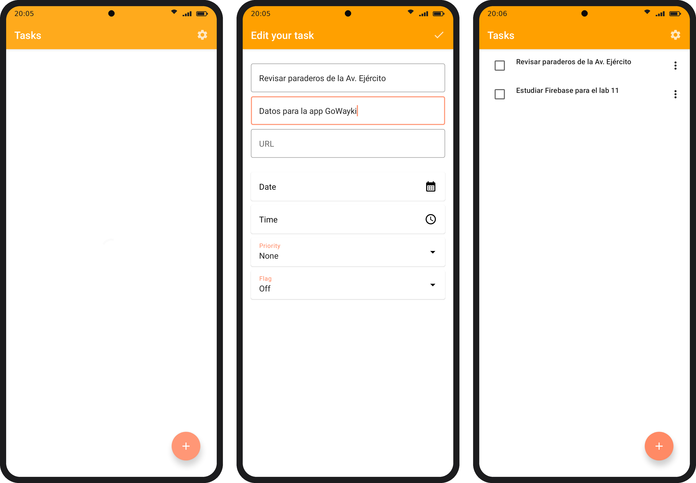
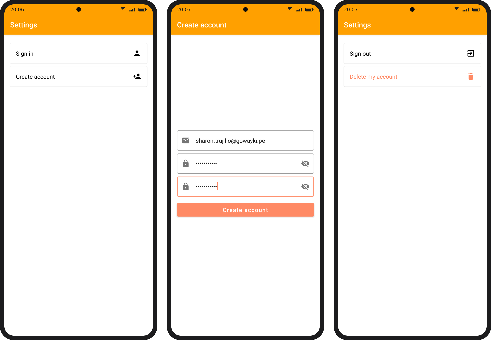
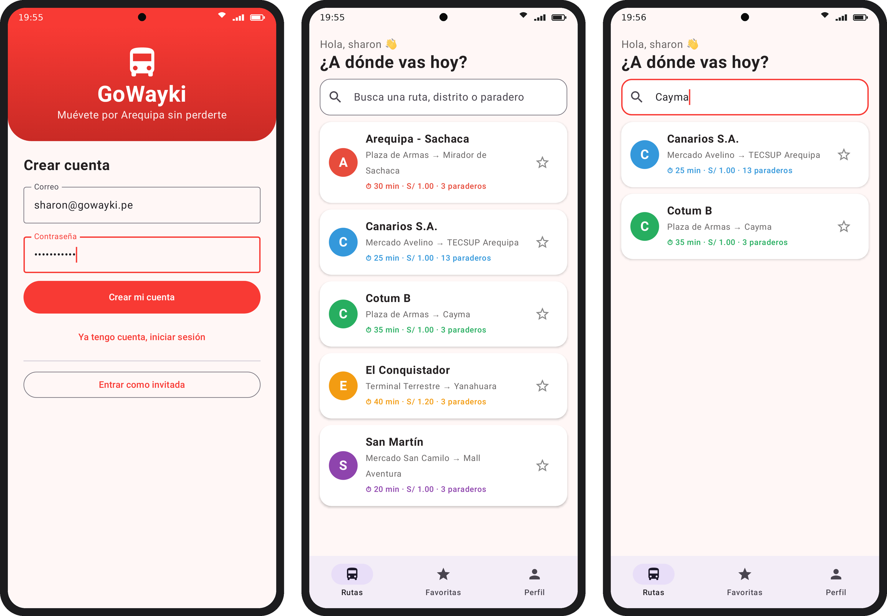
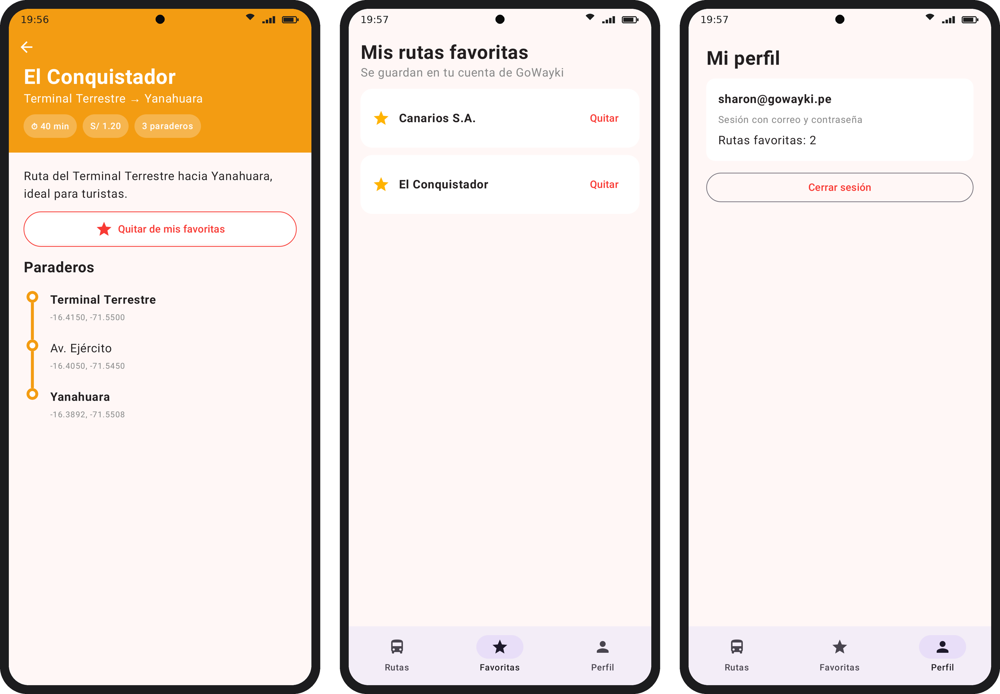

# Lab 11 – Firebase (Authentication + Cloud Firestore)

Programación en Móviles · Sharon Jennifer Trujillo Sulca · Grupo D

| Módulo | Qué es |
|---|---|
| `app/` | **Make It So** (proyecto base del laboratorio, `BparejaTec/Lab11_Start`) con la parte guiada: vincular la cuenta anónima con correo y contraseña, pantalla de configuración según el usuario y tareas en tiempo real desde Firestore (tag `parte-guiada`). |
| `gowayki/` | **GoWayki**, mi proyecto final de transporte público en Arequipa: inicio de sesión con correo o como invitada, rutas y paraderos en Firestore y "Mis rutas favoritas" por usuario en tiempo real (tag `ejercicio`). |
| `firebase/` | Reglas de seguridad de Firestore (`firestore.rules`) publicadas en el proyecto `gowayki-lab11`. |

## Cómo correrlo

Las dos apps se conectan al proyecto real de Firebase **gowayki-lab11** (archivos `app/google-services.json` y
`gowayki/google-services.json`), que tiene habilitados Authentication (correo/contraseña y anónimo) y Cloud Firestore
con las reglas de `firebase/firestore.rules`.

Abrir el proyecto en Android Studio y correr `app` (variante `devDebug`) o `gowayki` en un emulador con Internet.

## Videos

- Make It So (parte guiada): https://drive.google.com/file/d/1mkvzO0t_anl5LUYVKqBuWBePRuke2WEp/view?usp=sharing
- GoWayki (ejercicio): https://drive.google.com/file/d/1ZmnAwVc8r3pzLght6ERfF-hSYke_P00z/view?usp=sharing

## Capturas

