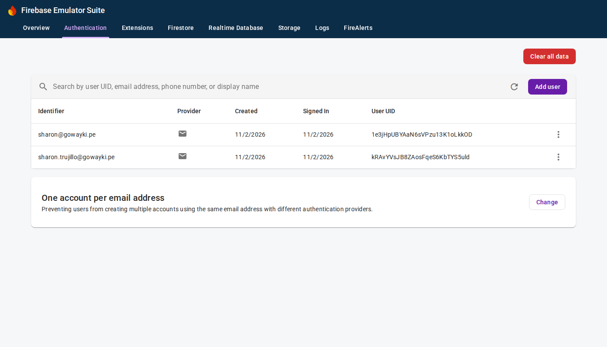
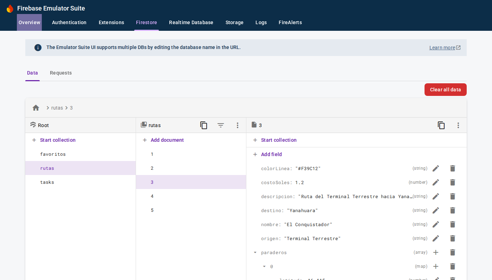

# Lab 11 – Firebase (Authentication + Cloud Firestore)

Programación en Móviles · Sharon Jennifer Trujillo Sulca · Grupo D

| Módulo | Qué es |
|---|---|
| `app/` | **Make It So** (proyecto base del laboratorio, `BparejaTec/Lab11_Start`) con la parte guiada: vincular la cuenta anónima con correo y contraseña, pantalla de configuración según el usuario y tareas en tiempo real desde Firestore (tag `parte-guiada`). |
| `gowayki/` | **GoWayki**, mi proyecto final de transporte público en Arequipa: inicio de sesión con correo o como invitada, rutas y paraderos en Firestore y "Mis rutas favoritas" por usuario en tiempo real (tag `ejercicio`). |
| `firebase/` | Configuración del **Firebase Emulator Suite** (Authentication + Firestore) y las reglas de seguridad `firestore.rules`. |

## Cómo correrlo

1. Instalar las herramientas de Firebase y levantar los emuladores:
   ```sh
   npm install -g firebase-tools
   cd firebase
   firebase emulators:start --project demo-gowayki
   ```
   La consola de los emuladores queda en http://127.0.0.1:4000.
2. Abrir el proyecto en Android Studio y correr `app` (variante `devDebug`) o `gowayki` en el emulador de Android.
   Las apps se conectan a `10.0.2.2` (la PC vista desde el emulador).

Para usar un proyecto real de la consola de Firebase: reemplazar `app/google-services.json` y `gowayki/google-services.json`
por los descargados de la consola, publicar `firebase/firestore.rules` y quitar las llamadas a `useEmulator`
(`FirebaseModule.kt` y `GoWaykiApp.kt`).

## Videos

- Make It So (parte guiada): https://drive.google.com/file/d/1mkvzO0t_anl5LUYVKqBuWBePRuke2WEp/view?usp=sharing
- GoWayki (ejercicio): https://drive.google.com/file/d/1ZmnAwVc8r3pzLght6ERfF-hSYke_P00z/view?usp=sharing

## Capturas




